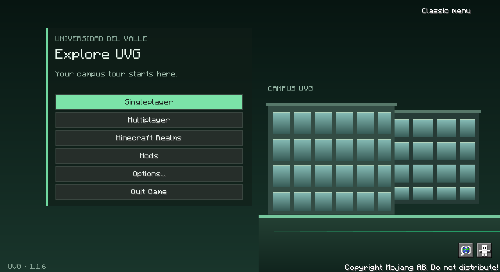

<p align="center">
  
</p>

<p align="center">
  <a href="https://github.com/jacobjuarezguerra/uvg-minecraft-mods/actions/workflows/validate.yml"></a>
  
  
  
</p>

<p align="center">
  <strong>Explorar el campus, conocer sus espacios y construir sus detalles.</strong><br>
  Dos mods para el recorrido virtual de la Universidad del Valle de Guatemala.
</p>

<p align="center">
  <a href="entrega-5/Quinta%20Entrega%20UVG%20Minecraft.pdf"><strong>Informe de la quinta entrega</strong></a>
  &nbsp; · &nbsp;
  <a href="entrega-5/VIDEOS.md"><strong>Los cuatro videos</strong></a>
  &nbsp; · &nbsp;
  <a href="#usar-los-mods">Instalación</a>
</p>

---

## Quinta entrega

La entrega final está en **[entrega-5](entrega-5)**. Se conserva este enlace para acceder al material ya entregado.

| Documento | Contenido |
| --- | --- |
| [Informe del proyecto · PDF](entrega-5/Quinta%20Entrega%20UVG%20Minecraft.pdf) | Alcance, planificación, implementación, pruebas, reflexiones y registros individuales. |
| [Videos y retroalimentación](entrega-5/VIDEOS.md) | Los cuatro enlaces de interacción con usuarios y las mejoras solicitadas. |
| [Registro técnico de pruebas](pruebas/RESULTADOS_PRUEBAS.json) | Versiones verificadas, resultados y huella del archivo compilado. |

## Los mods

| University Guide · 1.1.6 | Posted Signage · 1.7.3 |
| --- | --- |
| Guía permanente y destinos del campus. | Letreros, carteles y objetos para interiores. |
| Navegación, paradas y barreras de exclusión. | Vidrios conectados y puertas. |
| Libro de instrucciones y menú con distancia y descripción. | Herramientas de texturizado y construcción. |
| Pantalla de inicio UVG y opción de menú clásico. | Fuentes editables de modelos y texturas. |

<details>
<summary><strong>Ver la pantalla de inicio</strong></summary>



La pantalla conserva los accesos a mundos, multijugador, mods y opciones. El botón de menú clásico permite volver a la apariencia de Minecraft durante la sesión.

</details>

## Usar los mods

1. Instalar **Minecraft Java 1.21.1**, **Java 21** y **NeoForge 21.1.248 o superior**. También se verifica **21.1.250**.
2. Colocar los archivos `.jar` compilados de ambos mods en la carpeta `mods` de la instancia. En multijugador, actualizar también el servidor.
3. Al entrar, cada jugador recibe una vez el libro de instrucciones. Puede recuperarlo con `/universityguide book`, sin permiso de operador.

El recorrido utiliza el guía permanente del mapa. Su menú muestra nombre, distancia y una descripción breve de cada destino. La edición de elementos administrativos conserva sus requisitos de permisos.

Los archivos compilados están disponibles en los artefactos de una [ejecución correcta de GitHub Actions](https://github.com/jacobjuarezguerra/uvg-minecraft-mods/actions/workflows/validate.yml), iniciando sesión en GitHub, o compilando el proyecto. University Guide 1.1.6 debe actualizarse en **cliente y servidor** porque el protocolo de destinos incluye descripciones.

## Código y comprobaciones

| Carpeta | Qué contiene |
| --- | --- |
| [mods/university-guide](mods/university-guide) | Guía, navegación, comandos e interfaz. |
| [mods/posted-signage](mods/posted-signage) | Señalización, bloques y herramientas. |
| [modelos/posted-signage](modelos/posted-signage) | Modelos de Blockbench y recursos editables. |
| [herramientas](herramientas) | Compilación y comprobaciones del repositorio. |

Desde la raíz del repositorio, en PowerShell:

```powershell
powershell -NoProfile -ExecutionPolicy Bypass -File herramientas/compilar.ps1
```

Las pruebas locales registran **33 GameTests de University Guide y 65 de Posted Signage: 98 por versión de NeoForge**, tanto en .248 como en .250. Las pruebas de puertas CIT requieren ambos mods. La compilación automática puede consultarse en la insignia superior.

Se sigue trabajando en el rendimiento de zonas con muchos elementos. Todavía no hay una medición comparable que permita atribuir una mejora concreta de FPS.

## Equipo

[Jacob Juárez Guerra](https://github.com/jacobjuarezguerra) · [Diego](https://github.com/DiegoI-MM) · [Oskar](https://github.com/Oskar-07) · [Ricardo](https://github.com/RicardoSand1)

<details>
<summary>Entregas anteriores</summary>

- [Informe de la cuarta entrega](Cuarta_Entrega_UVG_Minecraft.pdf)
- [Reflexión de las entregas](Reflexi%C3%B3n%20de%20las%20entregas.docx)
- [Videos anteriores](videos.docx)

</details>
